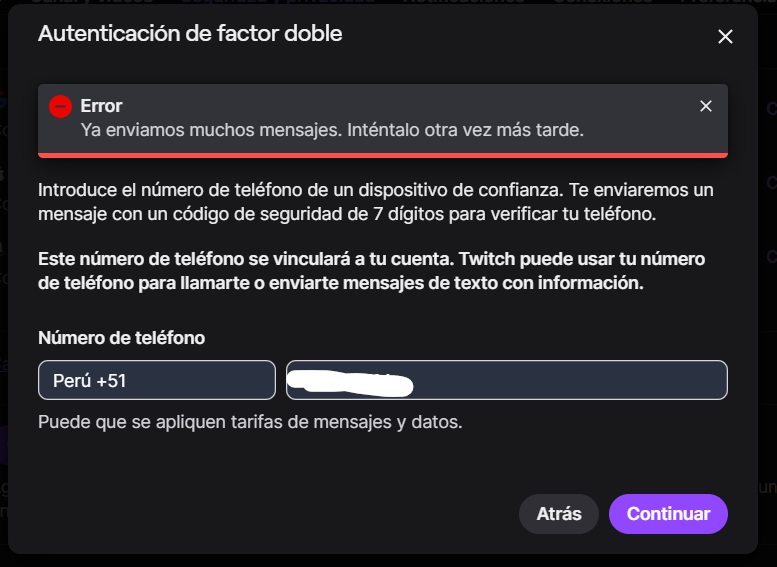

# Unidad2_APIs_REST_Tarea
# Desarrollo de una API con FastAPI, MySQL y Twitch

## Introducción

Para esta tarea se realizo una API con FastAPI y MySQL para realizar consultas de las
preferencias del usuario. Para consultar la información de los streamers se requiere
autenticarse con un client_id y client_secret y obtener un access_token. Para esta
ocasión hubo inconvenientes para realizar la autenticación de dos pasos que requiere
Twitch para utilizar su herramienta "Developer Console", por lo que se utilizó la
herramienta Twitch CLI en su lugar, ejecutándose de manera local.

---

## Conexión a base de datos

Se define la clase `DatabaseConnection`, la cual almacena los parámetros de conexión
y `get_db_connection` para abrir la conexión con la base de datos con MySQL usando
importando `mysql.connector`.

---

## Servicio de Twitch

Se gestiona la autenticación y consulta de datos de streamers. `get_token` obtiene un
token de acceso OAuth mediante el flujo `client_credentials`. `get_twitch_data_specific_try`

---

## Rutas y modelos de FastAPI

Carga las variables de entorno con `load_dotenv` y crea la instancia `app = FastAPI()`

### Modelos Pydantic

- **`UserCreate`**: valida `username` y `age` (restringiendo la edad entre 0 y 120)
  al crear o actualizar usuarios.
- **`StreamerReaction`**: define `user_id`, `streamer_login` y reacción (limitado a
  `"like"` o `"dislike"`).
- **`PlaylistCreate`** y **`PlaylistStreamerAdd`**: estructuran los datos para crear
  una lista (`user_id`, nombre, descripción opcional) y para agregar un streamer a una
  lista (`playlist_id`, `streamer_login`, `position`).

### Endpoints principales

**Estado de la API (`GET /`):** responde `{"message": "API Twitch active"}` para
verificar que la API esta activa.

**CRUD de usuarios:** abren conexion con `DatabaseConnection`, ejecutan las sentencias
SQL sobre la tabla `users`, hacen `commit()` en escrituras y devuelven códigos HTTP
como `201`, `400` o `404` según corresponda.

**Consulta de streamer:** llama a `get_twitch_data_specific_try(login, ...)`. Si
devuelve `"error"`, lanza `HTTPException(status_code=404)`; si no, retorna los datos
del streamer en JSON.

**Preferencias / reacciones:**

- En `POST /reactions`, primero consulta el streamer en Twitch para obtener su `id` y
  `login` reales. Luego revisa en `streamer_reactions` si ese `user_id` ya tiene una
  reacción para ese `streamer_id`: si existe, la actualiza (`UPDATE`); si no, la
  inserta (`INSERT`).
- En `GET /reactions/{user_id}`, consulta todas las reacciones guardadas para el
  `user_id` indicado.

**Listas de reproducción:**

- `POST /playlists` inserta una nueva lista en `playlists` y devuelve el `id` generado.
- `POST /playlists/streamers` valida primero el `streamer_login` con
  `get_twitch_data_specific_try(...)` y luego guarda el registro (`playlist_id`,
  `streamer_id`, `streamer_login`, `position`) en `playlist_streamers`.
- `GET /playlists/user/{user_id}` obtiene las listas del usuario y, para cada lista,
  consulta sus streamers ordenados por `position` para devolverlos anidados dentro de
  cada lista.

---

## Conclusiones y observaciones

- El uso de Twitch CLI (`mock-api`) permitio completar toda la practica y validar la
  integración con el flujo de token y consulta de streamers a pesar del bloqueo de 2FA
  en la cuenta real.
- Separar la logica de Twitch en `service/twitch_service.py` y la conexión en
  `configuration/connections.py` hizo que las rutas fueran fáciles de leer y probar
  paso a paso.
- Como puntos a pulir en futuras versiones: cerrar explicitamente cursores y conexiones
  tras cada consulta, pasar parámetros SQL de forma segura y leer todos los datos de
  conexión de MySQL desde variables de entorno.
